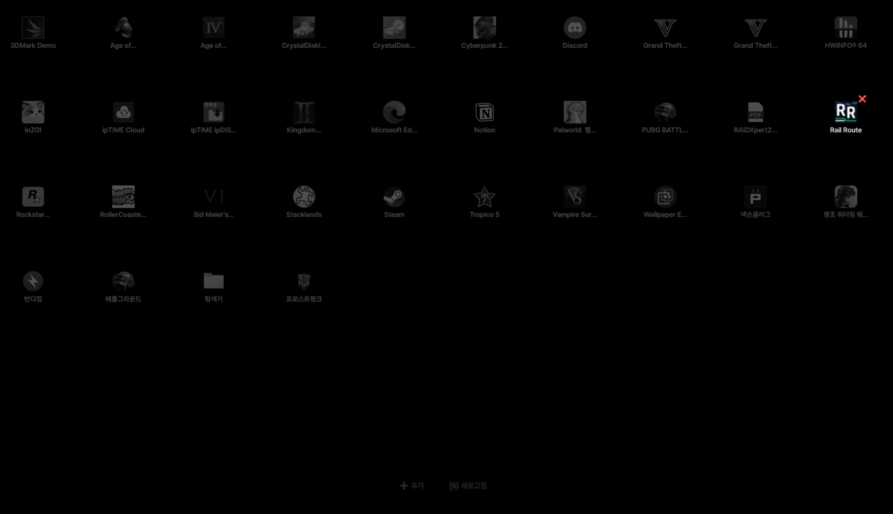

# 🌌 Rainmeter Desktop Dashboard for OLED Monitor



초기 버전은 Google Gemini를 이용하여 제작했습니다.

**Rainmeter Desktop Dashboard**는 OLED 모니터에서 바탕화면 아이콘을 대신 표시하는 Rainmeter 스킨입니다. 픽셀 시프팅과 흑백 모드의 낮은 불투명도로 고정된 아이콘의 표시 위치와 밝기를 조절합니다.

`@Resources\Shortcuts` 폴더에 바로가기 파일(`.lnk`, `.url`)을 넣고 하단의 **🔄 새로고침**을 누르면 아이콘이 표시됩니다.

---

## ✨ 주요 기능 (Key Features)

### 🛡️ Pixel Shifting

* 스킨을 불러올 때 현재 모니터의 중앙을 기준으로 배치합니다.
* 설정한 주기마다 스킨 전체를 이동합니다. 기본 주기는 `3600`초(1시간)입니다.
* 가로와 세로 오프셋은 각각 `-4, -2, 0, 2, 4`픽셀입니다. 가로 방향을 한 바퀴 이동할 때마다 세로 위치를 바꿔 총 25개 위치를 순회합니다.

### ◐ 컬러·흑백 전환과 호버

**➕ 추가**와 **🔄 새로고침** 사이의 **◐ 컬러 / ◐ 흑백** 버튼은 현재 모드를 표시합니다. 누를 때마다 모드가 바뀌며, 선택한 값은 `Variables.inc`에 저장되어 스킨을 다시 불러와도 유지됩니다.

기본 설정에서 바로가기 아이콘과 이름은 다음과 같이 표시됩니다. 불투명도는 0~255 범위이며, 값이 낮을수록 투명해집니다.

| 모드 | 평상시 아이콘 | 평상시 아이콘·이름 불투명도 | 마우스를 올렸을 때 |
| --- | --- | --- | --- |
| 컬러 | 원래 컬러 | 255 | 원래 컬러, 아이콘·이름 모두 255 |
| 흑백 | 흑백 | 20 | 해당 아이콘이 원래 컬러로 바뀌고 아이콘·이름 모두 255 |

마우스를 떼면 선택한 모드의 색상과 불투명도로 돌아갑니다.

### ⚡ 툴팁

* 표시 너비를 넘는 이름은 말줄임표로 줄여 표시합니다.
* 바로가기 영역에 마우스를 0.5초 이상 올려두면 전체 이름이 툴팁으로 표시됩니다.
* 마우스를 떼면 대기 중인 타이머를 취소하고 툴팁을 즉시 숨깁니다.

### 📂 동적 아이콘 관리 & 자동 페이징

기본 배치는 10열 × 6행으로 한 페이지에 최대 60개를 표시합니다. 바로가기가 페이지 용량을 초과하면 **◀ 이전**과 **다음 ▶** 버튼이 나타납니다.

| 하단 메뉴 순서 | 동작 |
| --- | --- |
| ◀ 이전 | 이전 페이지로 이동 |
| ➕ 추가 | `@Resources\Shortcuts` 폴더 열기 |
| ◐ 컬러 / ◐ 흑백 | 컬러·흑백 모드 전환 |
| 🔄 새로고침 | 바로가기 폴더를 다시 읽어 목록 갱신 |
| 다음 ▶ | 다음 페이지로 이동 |

바로가기 영역을 클릭하면 해당 프로그램이나 URL을 엽니다. 마우스를 올리면 나타나는 **✖** 버튼은 `Shortcuts` 폴더의 해당 바로가기 파일을 즉시 삭제합니다.

### 🖼️ 아이콘 표시 크기

아이콘은 기본적으로 `48×48`픽셀 영역에 표시됩니다. FileView의 아이콘 추출 크기를 `Large`로 설정해 일부 아이콘이 큰 투명 여백 안에 작게 들어가 표시되던 문제를 보정했습니다.

---

## 📥 설치 방법 (Installation)

1. Windows에 Rainmeter를 설치합니다. [Rainmeter 다운로드](https://www.rainmeter.net/)
2. Releases에 게시된 `.rmskin` 패키지를 다운로드해 실행합니다. [Releases](../../releases)
3. Rainmeter 관리 창에서 `DesktopDashboard\Main.ini`를 불러옵니다.
4. 하단의 **➕ 추가**를 눌러 열린 폴더에 원하는 바로가기(`.lnk`, `.url`)를 넣고 **🔄 새로고침**을 누릅니다.

저장소의 소스로 설치하려면 Rainmeter의 스킨 폴더 아래에 `DesktopDashboard` 폴더를 만들고 저장소 내용을 넣습니다. Rainmeter 관리 창에서 **모두 새로고침**을 누른 뒤 `DesktopDashboard\Main.ini`를 불러옵니다.

설정된 글꼴은 **Pretendard SemiBold**입니다. 원하는 글꼴은 `Variables.inc`의 `FontName`에서 지정할 수 있습니다.

---

## ⚙️ 설정 및 조작 (Usage & Configuration)

`@Resources\Variables.inc`에서 설정을 수정한 뒤, 스킨을 우클릭해 **스킨 새로고침**을 실행합니다. 하단의 **🔄 새로고침**은 바로가기 목록을 갱신하는 버튼입니다.

### 1. 아이콘 순서 정렬하기

파일은 이름순으로 정렬합니다. `#001_Chrome.lnk`, `#002_Steam.lnk`처럼 같은 자릿수의 숫자 접두사를 붙이면 순서를 지정할 수 있습니다. 화면에는 접두사와 확장자를 제외한 `Chrome`, `Steam`이 표시됩니다.

### 2. 모드와 불투명도

| 변수 | 기본값 | 적용 대상 |
| --- | --- | --- |
| `IconGreyscale` | `0` | `0`은 컬러, `1`은 흑백. 전환 버튼으로 선택한 값이 저장됨 |
| `GreyscaleAlpha` | `20` | 흑백 모드에서 평상시 바로가기 아이콘과 이름 |
| `OffAlpha` | `255` | 컬러 모드의 평상시 아이콘·이름과 하단 메뉴의 평상시 글자 |
| `OnAlpha` | `255` | 마우스를 올린 바로가기 아이콘·이름과 하단 메뉴 글자 |

### 3. 배치, 글자와 이동 주기

| 변수 | 기본값 | 역할 |
| --- | --- | --- |
| `IconSize` | `48` | 아이콘 표시 영역의 가로·세로 크기 |
| `TextSize` | `11` | 바로가기 이름 글자 크기 |
| `TextWidth` | `100` | 바로가기 이름의 최대 표시 너비 |
| `FontName` | `Pretendard SemiBold` | 글꼴 |
| `TextColor` | `220,220,220` | 바로가기 이름의 RGB 색상 |
| `AreaW`, `AreaH` | `1920`, `1080` | 대시보드 전체 영역 |
| `Cols`, `Rows` | `10`, `6` | 한 페이지의 열·행 수 |
| `ShiftInterval` | `3600` | 픽셀 시프팅 간격. 현재 1초 업데이트 설정 기준으로 초 단위 |

하단 80픽셀은 메뉴 영역으로 확보합니다. `Cols × Rows`를 60보다 크게 설정하려면 `generator.py`의 `max_icons`도 해당 수 이상으로 늘리고 아이콘 정의를 다시 생성합니다.

---

## 🛠️ 개발자용 정보 (For Developers)

| 파일·폴더 | 역할 |
| --- | --- |
| `Main.ini` | FileView, 하단 메뉴, 모드 표시, 툴팁 타이머 및 화면 구성 |
| `@Resources/Variables.inc` | 사용자 설정과 저장된 컬러·흑백 모드 |
| `@Resources/Meters.inc` | 공통 스타일과 60세트의 바로가기 측정값·표시 요소 |
| `@Resources/Scripts/Layout.lua` | 배치, 페이징 버튼 표시, 모드 저장, 툴팁, 삭제, 픽셀 시프팅 |
| `@Resources/Scripts/InitializeResources.ps1` | 바로가기·아이콘 캐시 폴더 생성 및 패키지 제외를 위한 숨김 속성 설정 |
| `@Resources/Shortcuts/` | 사용자가 추가하는 `.lnk`, `.url` 바로가기 |
| `@Resources/IconCache/` | FileView가 생성하는 아이콘 캐시 |
| `generator.py` | `Meters.inc` 생성 템플릿 |

아이콘이나 이름의 공통 표시·호버 동작을 수정할 때는 `generator.py`를 편집하고, Python 3으로 저장소 루트에서 실행합니다.

```powershell
python generator.py
```

실행하면 `@Resources/Meters.inc`를 직접 덮어씁니다. 생성 후 스킨을 새로고침해 반영합니다. Python은 이 파일을 재생성할 때 사용합니다.

* `StyleShortcutIcon`과 `StyleShortcutText`가 평상시의 색상·불투명도를 정합니다. 호버가 끝나면 임시 설정을 해제해 모드별 스타일로 복귀합니다.
* 아이콘과 이름은 `ShortcutIcons` 그룹으로 묶여 모드 전환 시 함께 갱신됩니다.
* 툴팁 타이머는 500ms 뒤 `ShowToolTip()`을 호출하고, Lua가 기억한 현재 호버 대상의 이름을 읽습니다.
* FileView의 `IconSize=Large`는 추출 크기 옵션이며, `Variables.inc`의 `IconSize=48`은 화면 표시 크기를 정합니다.

### .rmskin 패키지 만들기

스킨을 불러오거나 새로고침하면 Windows PowerShell이 `Shortcuts`와 `IconCache` 폴더를 생성하고 숨김 속성을 설정합니다. Rainmeter의 Skin Packager는 숨김 파일과 폴더를 제외하므로 개인 바로가기와 생성된 아이콘 캐시가 패키지에서 빠집니다. 이전 버전이 스킨 루트에 만든 `icon1.ico` 등의 파일도 숨김 처리합니다. [Rainmeter 패키징 문서](https://docs.rainmeter.net/manual/distributing-skins/index.html)

1. `DesktopDashboard\Main.ini`를 새로고침하고 바로가기 목록이 나타날 때까지 기다립니다.
2. Rainmeter 관리 창의 **.rmskin 패키지 만들기**에서 `DesktopDashboard` 스킨 폴더를 선택합니다.
3. 기존 사용자의 바로가기 폴더를 유지하며 업데이트하려면 **Advanced → Merge skins**를 선택합니다.
4. 패키지 정보와 저장 위치를 지정한 뒤 **Create package**를 누릅니다.

Git으로 새로 받은 폴더를 스킨 실행 없이 패키징할 때는 저장소 루트에서 다음 명령을 먼저 실행합니다. Windows의 숨김 속성은 Git에 저장되지 않습니다.

```powershell
powershell.exe -NoProfile -ExecutionPolicy Bypass -File ".\@Resources\Scripts\InitializeResources.ps1"
```

설치된 스킨을 처음 불러오면 필요한 폴더가 자동으로 준비됩니다. **➕ 추가**로 바로가기 폴더를 열어 아이콘을 추가할 수 있습니다.

---

## 📜 라이선스 (License)

이 프로젝트는 [MIT License](LICENSE)를 따릅니다.
